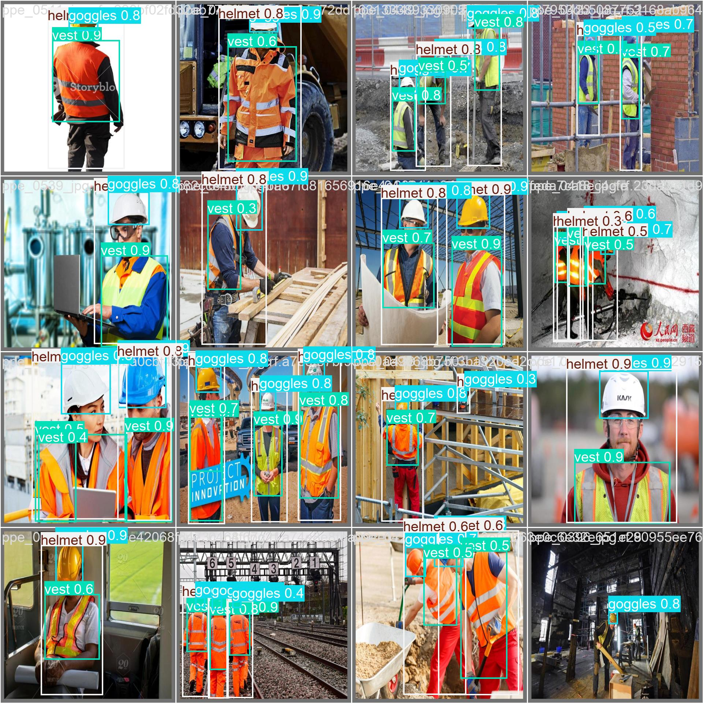
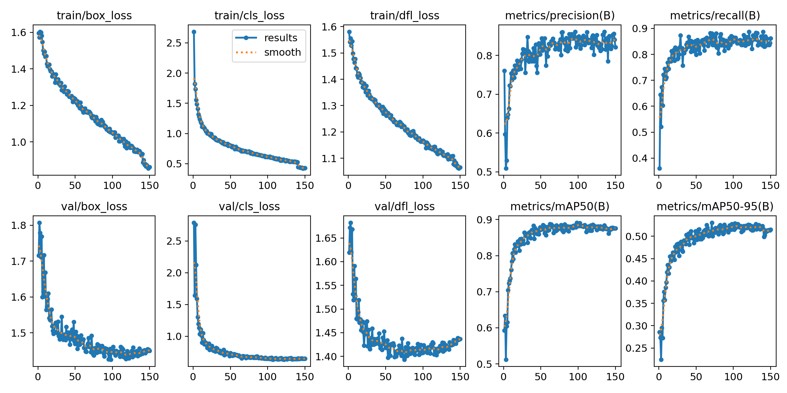

# Entrenamiento de modelos YOLOv11 para detección de EPP

Scripts y configuraciones para entrenar y comparar modelos de detección de objetos YOLOv11 orientados a elementos de protección personal (EPP).


<p align="center"></p>

## Tabla de contenidos

- [Descripción](#descripción)
- [Estado del proyecto](#estado-del-proyecto)
- [Características](#características)
- [Tecnologías](#tecnologías)
- [Requisitos](#requisitos)
- [Instalación](#instalación)
- [Uso](#uso)
- [Dataset](#dataset)
- [Resultados](#resultados)
- [Estructura del proyecto](#estructura-del-proyecto)
- [Licencia](#licencia)
- [Autor](#autor)

## Descripción

El repositorio reúne el flujo de entrenamiento usado para obtener un detector de EPP (gafas, casco, persona y chaleco) con Ultralytics YOLOv11. Incluye un entrenamiento base, varias versiones con hiperparámetros afinados (`tuned`, `v2`, `v3`, `v4`), el historial de ejecuciones en `runs/` y un script que resume las métricas de cada ejecución. Los pesos resultantes se utilizan en el proyecto [Detector-EPP-Yolo11](https://github.com/ViceAguilera/Detector-EPP-Yolo11).

## Estado del proyecto

**Terminado.** El flujo de entrenamiento está completo y los pesos obtenidos se usan en Detector-EPP-Yolo11.

## Características

- Entrenamiento base con `yolo11n.pt` (`main.py`).
- Entrenamientos afinados con `yolo11s.pt`, con hiperparámetros definidos en archivos YAML (`tuned*.yaml`).
- Dataset descrito en `config.yaml` con 4 clases: `goggles`, `helmet`, `person`, `vest`.
- Resumen automático de métricas de todos los entrenamientos con `analyze_runs.py`.

## Tecnologías

- Python 3.9
- [Ultralytics](https://ultralytics.com/) (YOLOv11)
- PyTorch (se sugiere la versión con CUDA 11.8)
- PyYAML

## Requisitos

- Python 3.9
- GPU NVIDIA con CUDA recomendada
- Dataset en formato YOLO (ver sección [Dataset](#dataset))

## Instalación

```bash
git clone https://github.com/ViceAguilera/Train-YoloV11-Model.git
cd Train-YoloV11-Model
python -m venv venv
source venv/bin/activate        # En Windows: .\venv\Scripts\activate
pip install ultralytics

# PyTorch con CUDA 11.8
pip uninstall -y torch torchvision torchaudio
pip install torch torchvision torchaudio --index-url https://download.pytorch.org/whl/cu118
```

## Uso

```bash
# Entrenamiento base (yolo11n.pt, 150 épocas, imgsz 640, batch 16)
python main.py

# Entrenamientos afinados (yolo11s.pt, hiperparámetros en el YAML correspondiente)
python train_tuned.py
python train_tuned_v2.py
python train_tuned_v3.py
python train_tuned_v4.py

# Resumen de métricas de todas las ejecuciones en runs/
python analyze_runs.py
```

Equivalente por CLI del entrenamiento base:

```bash
yolo task=detect mode=train epochs=150 data=config.yaml model=yolo11n.pt imgsz=640 batch=16
```

## Dataset

El conjunto de datos de EPP proviene de Roboflow: [PPE Detection Using CV](https://universe.roboflow.com/ai-camp-safety-equipment-detection/ppe-detection-using-cv). No se incluye en el repositorio.

Para usarlo:

1. Edita la primera línea de `config.yaml` (`path`) con la ruta absoluta a la carpeta `data` de tu equipo.
2. Coloca el dataset en `data/train`, `data/valid` y `data/test`; cada carpeta debe tener `images/` con las imágenes y `labels/` con los archivos `.txt` en formato YOLO.

Nota: `train_tuned_v4.py` usa `construction-ppe/data.yaml` (dataset Construction-PPE), que tampoco se incluye.

## Resultados

Ultralytics guarda las métricas de cada ejecución en `runs/<nombre>/results.csv`, junto con gráficos (`results.png`, `PR_curve.png`, `confusion_matrix.png`, etc.). `analyze_runs.py` recorre `runs/` y muestra por ejecución el modelo, tamaño de imagen, batch, épocas, mejores `mAP50` y `mAP50-95` (y su época) y las métricas finales.

<p align="center"></p>

### Historial resumido

Valores aproximados y redondeados de las ejecuciones más relevantes:

| Run               | Modelo     | Img | Épocas | Best mAP50-95 | Best mAP50 | Época best | Final mAP50-95 | Final mAP50 |
|-------------------|-----------:|----:|-------:|--------------:|-----------:|-----------:|---------------:|------------:|
| `train`           | yolo11n.pt | 640 |    150 |         0.417 |      0.745 |         78 |          0.404 |       0.741 |
| `train3`          | yolo11n.pt | 640 |    300 |         0.206 |      0.389 |          4 |          0.206 |       0.389 |
| `train4`          | yolo11n.pt | 640 |    300 |         0.306 |      0.517 |         89 |          0.259 |       0.428 |
| `train5`          | yolo11n.pt | 640 |    100 |         0.283 |      0.476 |         77 |          0.270 |       0.456 |
| `train6`          | yolo11n.pt | 640 |    150 |         0.307 |      0.519 |         46 |          0.256 |       0.425 |
| `train11`         | yolo11n.pt | 640 |    150 |         0.516 |      0.882 |         54 |          0.494 |       0.862 |
| `train12`         | yolo11n.pt | 640 |    150 |         0.530 |      0.884 |         71 |          0.515 |       0.876 |
| `train_tuned2`    | yolo11s.pt | 800 |    180 |         0.504 |      0.869 |        166 |          0.495 |       0.864 |
| `train_tuned_v22` | yolo11s.pt | 640 |    160 |         0.506 |      0.865 |        127 |          0.496 |       0.852 |
| `train_tuned_v3`  | yolo11s.pt | 640 |   136* |         0.509 |      0.879 |        106 |          0.496 |       0.867 |

- El mejor resultado global registrado es `train12` (mAP50-95 ≈ 0.53, mAP50 ≈ 0.88).
- `train_tuned2` y `train_tuned_v22` usan `yolo11s.pt` y se acercan a `train12` sin superarlo.
- Los runs `train2`, `train7`, `train8`, `train9` y `train10` no tienen `results.csv` y no se incluyen en la tabla.

## Estructura del proyecto

```
main.py                  # Entrenamiento base (yolo11n.pt)
train_tuned*.py          # Entrenamientos afinados (yolo11s.pt)
tuned*.yaml              # Hiperparámetros de cada entrenamiento afinado
config.yaml              # Definición del dataset (rutas y clases)
analyze_runs.py          # Resumen de métricas de runs/
data/                    # Dataset (train, valid, test; no incluido)
runs/                    # Resultados de los entrenamientos
yolo11n.pt, yolo11s.pt   # Pesos base preentrenados
```

## Licencia

Distribuido bajo la licencia MIT. Ver [LICENSE](LICENSE).

## Autor

**Vicente Aguilera Arias** — [Portafolio](https://portfolio.iamsirius.cl) · [GitHub](https://github.com/ViceAguilera) · [LinkedIn](https://www.linkedin.com/in/vicenteaguilera/)
